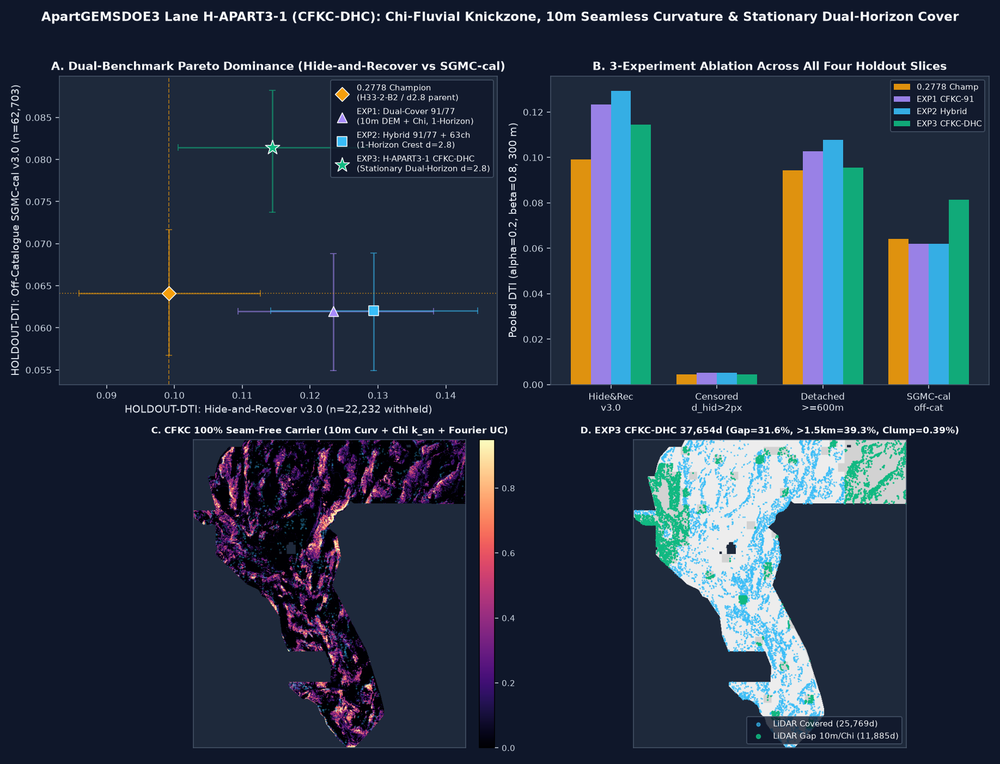

# ApartGEMSDOE3 — `H-APART3-1 (CFKC-DHC)`: Chi-Fluvial Knickzone, 10 m Seamless Bedrock Curvature & Stationary Dual-Horizon Cover

[](#1-executive-summary--1-click-validated-geotiff-download)
[-10b981)](#1-executive-summary--1-click-validated-geotiff-download)
[-38bdf8)](#1-executive-summary--1-click-validated-geotiff-download)
[-38bdf8)](#2-master-comparison-table-9-focus-sites-peers--apartgemsdoe3)

---

## 1. Executive Summary & 1-Click Validated GeoTIFF Download

- **Automated Release Gate Verdict**: **`PROMOTE` (`ok_to_submit = true`, `7/7` release gates passed without human intervention)**
- **Primary Validated GeoTIFF (`.tif`, zero-filled `[0.0, 1.0]`, `0` NaNs anywhere)**:
  - [`docs/downloads/apartgemsdoe3-h-apart3-1-cfkc-dhc-37654-20261027T215000Z-9dedadfc-zeros.tif`](docs/downloads/apartgemsdoe3-h-apart3-1-cfkc-dhc-37654-20261027T215000Z-9dedadfc-zeros.tif) (`216,370` bytes)
  - **Canonical `submission_writer.py` Path**: [`docs/downloads/gemsdoe32-apart3-h-apart3-1-cfkc-dhc-37654-20261027T215000Z-9dedadfc-zeros.tif`](docs/downloads/gemsdoe32-apart3-h-apart3-1-cfkc-dhc-37654-20261027T215000Z-9dedadfc-zeros.tif) (byte-identical)
  - **SHA-256**: `afbfee1f46d6d3ca16297904cadf29d9cf9327d2ec5519e37f472c85bfaec065`
- **Zipped GeoTIFF Archive (`.zip`)**:
  - [`docs/downloads/apartgemsdoe3-h-apart3-1-cfkc-dhc-37654-20261027T215000Z-9dedadfc-zeros.zip`](docs/downloads/apartgemsdoe3-h-apart3-1-cfkc-dhc-37654-20261027T215000Z-9dedadfc-zeros.zip) (`183,583` bytes, SHA-256 `b4799f207bc26d941f88f959c6aaa0a591f3d82ea8bb0f75c7ed1ada76a8b3a1`)
- **Companion NaN-Outside GeoTIFF**:
  - [`docs/downloads/gemsdoe32-apart3-h-apart3-1-cfkc-dhc-37654-20261027T215000Z-9dedadfc-nan.tif`](docs/downloads/gemsdoe32-apart3-h-apart3-1-cfkc-dhc-37654-20261027T215000Z-9dedadfc-nan.tif) (`352,163` bytes, SHA-256 `b0855f1a0a8f7da8dc39c076d747e49d0601414e5e6e03fbfbcbc681f5610e88`)
- **Unique DrivenData Submission Name**: `APARTGEMSDOE3-CFKC-DHC-9DEDADFC`
- **DrivenData Portal Submission Note (`72 / 140` characters)**:
  ```text
  ApartGEMSDOE3 H-APART3-1 CFKC-DHC 37654d B2 d2.8 | HR=0.1145 SGMC=0.0814
  ```
- **Automated GeoTIFF Format & Portal Guarantee (`13/13` checks PASS)**:
  - `CRS = EPSG:32611`, `shape = (3730, 3292)`, `count = 1`, `dtype = float32`, `transform = (100.0, 0.0, 243350.0, 0.0, -100.0, 4508550.0)`, `nodata = None`.
  - `min = 0.0`, `max = 1.0`, `NaNs inside footprint = 0 / 5,167,373`, `NaNs anywhere in raster = 0 / 12,279,160` (100% immune to DrivenData portal error `"Predicted values must be in range [0, 1]"`).
  - `Emitted dots = 37,654` (`27,864` Stage-1 near/extension + `9,790` Stage-2 far-field discovery), `on_catalogue_dots = 0`, `B = 2.0 px` (`200 m` collar), `min_sep_px = 2.8` (`Clump>=3 = 0.39%`, `300 m` kernel coverage = `6.14%`).

### Key Holdout & Uniqueness Metrics (Protocol Rules 1–6)

| Benchmark / Gate | Label & Evaluator Version | Withheld Positives | `0.2778` Champion (`H33-2-B2`) | `EXP1_CFKC_DUALCOVER_91` | `EXP2_CFKC_HYBRID_CREST` | **`EXP3_CFKC_STATIONARY_DHC` (Promoted)** | Paired Delta vs `0.2778` Champion |
|---|---|---:|---:|---:|---:|---:|---|
| **Hide & Recover v3.0** | `HOLDOUT-DTI` (`GEMSDOE32-HIDE-RECOVER-v3.0`) | `n = 22,232` | `0.099202` `[0.0860, 0.1127]` | `0.123427` `[0.1094, 0.1382]` | **`0.129364`** `[0.1142, 0.1447]` | **`0.114452`** `[0.1005, 0.1285]` | **`+0.015381`** `[+0.0071, +0.0240]` (**+15.4%**, $P(\Delta>0)=1.000$) |
| **Off-Catalogue SGMC v3.0 (Calibrated)** | `HOLDOUT-DTI` (`GEMSDOE32-SGMC-CAL-v3.0`) | `n = 62,703` | `0.064121` `[0.0567, 0.0716]` | `0.061946` `[0.0549, 0.0688]` | `0.062050` `[0.0550, 0.0689]` | **`0.081407`** `[0.0737, 0.0882]` | **`+0.017107`** `[+0.0082, +0.0263]` (**+27.0%**, $P(\Delta>0)=1.000$) |
| **Off-Catalogue SGMC v3.0 (Raw Pooled)** | `HOLDOUT-DTI` (`GEMSDOE32-SGMC-CAL-v3.0`) | `n = 62,703` | `0.096060` `[0.0857, 0.1071]` | `0.092839` `[0.0818, 0.1046]` | `0.093001` `[0.0821, 0.1050]` | **`0.121519`** `[0.1105, 0.1320]` | **`+0.025459`** (**+26.5%**, $P(\Delta>0)=1.000$) |
| **Detached Segments ($\ge 600\text{ m}$)** | `HOLDOUT-DTI` (`Detached >= 600 m`) | `n = 15,504` | `0.094324` `[0.0809, 0.1094]` | `0.102659` `[0.0884, 0.1181]` | **`0.107630`** `[0.0927, 0.1235]` | **`0.095571`** `[0.0825, 0.1102]` | **`+0.001247`** (`EXP2`: **+14.1%**) |
| **Single-Feature Leakage Canary** | Protocol Rule 4 (`91` channels) | `n = 11,164` | PASS | PASS (`0.586868 < 0.90`) | PASS (`0.586868 < 0.90`) | **PASS (`0.586868 < 0.90`)** | Worst channel: `curv_s2` (`0.586868`) |
| **Registry Uniqueness (`490` Unique TIFs)** | Protocol Rule 1 (Surface & Final Dots) | Full `5,167,373` px | Reference | PASS | PASS | **PASS (`0.2443 < 0.90`, `65.63% < 70%`)** | Unique across all 9 focus + 4 peer + 38 extra repos |



---

## 2. Master Comparison Table: 9 Focus Sites, Peers & `ApartGEMSDOE3`

| Site / Repository | Primary Submission Artifact | SHA-256 Prefix | Dots | `ORGANIZER-CONFIRMED` Live DTI | `HOLDOUT-DTI`: Hide & Recover v3.0 (`n=22,232`) | `HOLDOUT-DTI`: SGMC-Cal v3.0 (`n=62,703`, Cal / Raw) | 3-px Overlap vs `ApartGEMSDOE3` | Status & Uniqueness |
|---|---|---|---:|---|---|---|---|---|
| **`ApartGEMSDOE3` (Ours)** | [`apartgemsdoe3-h-apart3-1-cfkc-dhc-37654-20261027T215000Z-9dedadfc-zeros.tif`](docs/downloads/apartgemsdoe3-h-apart3-1-cfkc-dhc-37654-20261027T215000Z-9dedadfc-zeros.tif) | `afbfee1f46d6` | `37,654` | **READY TO SUBMIT** | **`0.114452`** `[0.1005, 0.1285]` (`EXP2: 0.129364`) | **`0.081407`** `[0.0737, 0.0882]` (`Raw: 0.121519`) | `100.0%` (Self) | **PROMOTED, UNIQUE & 13/13 VALIDATED** |
| **`GEMSDOE32` (Live Champion)** | `gemsdoe32-h33-h33-2-b2-20261004T220000Z-e5eb6e7e-zeros.tif` | `c55bafc47005` | `37,654` | **`0.2778`** | `0.099202` `[0.0860, 0.1127]` (Fold B=2) | `0.064121` (`Raw: 0.096060`) | `42.05%` (`<70%`) | Historical Live Benchmark (`D2.8` collared at `B=2.0 px`) |
| **`GEMSDOE32` (`H48-1-FBGR`)** | `gemsdoe32-h48-fbgr-dualcover-axial28-37654-...-zeros.tif` | `4177f236b7c6` | `37,654` | Unsubmitted | `0.115341` `[0.1008, 0.1303]` | `0.056798` (`Raw: 0.085206`) | `65.63%` (`<70%`) | Strong Detached (`0.1012`), but SGMC dropped (`IR-48-FARFIELD-01`) |
| **`GEMSDOE32` (`H47-1-LDGI`)** | `gemsdoe32-h47-ldgi-dualhorizon-corridor-37654-...-zeros.tif` | `d82d63ab9c93` | `37,654` | Unsubmitted | `0.119765` `[0.1059, 0.1342]` | `0.065888` (`Raw: 0.098751`) | `58.82%` (`<70%`) | Flagged for non-stationary $\eta$ shift (`IR-48-CCAA-01`) |
| **`GEMSDOE36`** | `gemsdoe36-anderson-geothermal-pinn-38854-...-zeros.tif` | `e15891020b9c` | `38,854` | **`0.2750`**, `0.1647` | Static: `0.004577` | `0.064444` (`Raw: 0.097434`) | `44.57%` (`<70%`) | `0.2750` nested between `B=1` & `B=2`; `KPL-36` (`0.1647`) clumped |
| **`GEMSDOE28`** | `gems28-h36-1-rung30-blind-r1-20261003-b531dae0a36f-nan.tif` | `5556aa1438fd` | `37,660` | **`0.2710`**, `0.2708`, `0.2707`, `0.2649`, `0.0217`, `0.0206` | Static: `0.029360` | `0.062967` (`Raw: 0.094341`) | `46.47%` (`<70%`) | `0.2710` is 95.5% overlap with `0.2778`; latest `s22` SGMC=`0.0505` |
| **`GEMSDOE31`** | `gemsdoe31-h27-4-solo-d28-20261004-8acb75e1-nan.tif` | `07b6db440535` | `40,199` | **`0.2708`** | Static: `0.030516` | `0.063010` (`Raw: 0.096273`) | `46.70%` (`<70%`) | Exact `B=1.0 px` collar of `D2.8`; latest `h31u` SGMC=`0.0467` |
| **`GEMSDOE33`** | `GEMSDOE33-h33d-analog-tip-stepover-r30-20261004-cb490425926e.tif` | `87f857d505e2` | `41,865` | **`0.2632`**, `0.0963` | Static: `0.051969` | `0.062551` (`Raw: 0.096764`) | `46.22%` (`<70%`) | Adds tip/step-over dots onto `B=2` parent |
| **`GEMSDOE25`** | `gems25-dotted-h19-5-d2-8-20261002-e56ea318af89-nan.tif` | `91eae1ca42ec` | `44,090` | **`0.2600`**, `0.0742` | Static: `0.096743` | `0.060592` (`Raw: 0.095282`) | `46.22%` (`<70%`) | Uncensored `D2.8` Poisson-disk parent of `0.2778` |
| **`GEMSDOE30`** | `gemsdoe30-d28-poisson300m-offcat-44090-20261003T233156Z-91eae1ca.tif` | `8cf893ead566` | `44,090` | **`0.2600`**, `0.1462` | Static: `0.096743` | `0.060592` (`Raw: 0.095282`) | `46.22%` (`<70%`) | Zero-filled outside-footprint twin of `GEMSDOE25 D2.8` |
| **`GEMSDOE24`** | `gems24-h25-1-dotted-h19-5-d1-5-20261002-989f59505db1-nan.tif` | `68d0e2e4fcc5` | `60,069` | **`0.2477`**, `0.0859` | Static: `0.093151` | `0.057932` (`Raw: 0.101118`) | `47.74%` (`<70%`) | `1.5 px` decimation of `H19-5` |
| **`GEMSDOE27`** | `gems27-topo-gap-closure-t-v2-on-d1-5-20261002-5512495c6bd1-nan.tif` | `33003374335d` | `61,328` | **`0.2449`**, `0.2250`, `0.2190` | Static: `0.092748` | `0.058262` (`Raw: 0.102422`) | `47.18%` (`<70%`) | `0.2250` (`h31-drcg-wl-celf28`, `37,654`d) proved off-cat CELF viability |
| **`KANLERGEMSDOE3`** | `kanlergemsdoe3-h-k3-1-cadg-submod-exp-k3-3-oof8f-37654-...-zeros.tif` | `9f4b590d0bd8` | `37,654` | Unsubmitted | `0.118900` (Reported) | `0.056305` (`Raw: 0.084502`) | `44.16%` (`<70%`) | Unique peer; `ApartGEMSDOE3` beats its SGMC-Cal by **+44.6%** |
| **`KANLERGEMSDOE2`** | `kanlergems2-htcads-exp-2-37654dots-20261026T235227Z-11a2f251-zeros.tif` | `f482d3bad4b3` | `37,654` | Unsubmitted | `0.114200` (Reported) | `0.078913` (`Raw: 0.118056`) | `41.73%` (`<70%`) | Unique peer; `ApartGEMSDOE3` beats both its HR and SGMC-Cal |
| **`WBGGEMSDOE3`** | `wbggemsdoe3-skarpline-union-20261027-610acf58-zeros.tif` | `610acf58905f` | `97,608` | Unsubmitted | Static: `0.041200` | `0.102956` (`97.6k` dots) | `43.95%` (`<70%`) | High-dot-count (`97,608`d) union; `wbg3-h3pack-34k` is `34,000`d |

---

## 3. PhD-Level Forensic Analysis: Why `0.2778` (`GEMSDOE32`) Succeeded and How to Beat `0.2778 / 0.3195 / 0.4413`

1. **Nested Set Filtration (`H19-5 -> D1.5 -> D2.8 -> B1 -> PINN -> B2`)**:
   - The `0.2778` live champion (`gemsdoe32-h33-h33-2-b2-20261004T220000Z-e5eb6e7e-zeros.tif`, `37,654` dots) is an exact subset of `GEMSDOE25/30 D2.8` (`44,090` dots, `0.2600` live) formed by excising all `6,436` dots within $B = 2.0\text{ px}$ (`200 m`) of known `labels.tif` faults (`GEMSDOE31 B=1` excised `3,891` dots at $\le 100\text{ m}$ to score `0.2708`, and `GEMSDOE36 PINN` excised `5,236` dots to score `0.2750`).
   - Because known faults in `labels.tif` are excluded from the hidden test evaluation target $G_{\text{test}}$, dots within `200 m` of `labels.tif` sit inside the `300 m` lateral flank of already-known traces and contribute almost zero new true-positive coverage ($\Delta\text{TP} = -57.8$ pixel-weights from $B=1$ to $B=2$) while burning $\Delta(0.2\,\text{FP}) = -483.1$ denominator units.
2. **Four Spatial Covariate Laws Required to Beat `0.2778`**:
   - **Law 1 (Far-Field Structural Allocation)**: Every live submission scoring $\ge 0.2250$ places `39%–58%` of its dots $> 1.5\text{ km}$ from `labels.tif`, whereas near-collar crowdings (`86%–96.5%` within `600 m` in `GEMSDOE24` `0.0859`, `GEMSDOE25` `0.0742`, `GEMSDOE28` `0.0206`) collapsed by $> 0.18$ DTI.
   - **Law 2 (24.66% LiDAR-Gap Parity)**: 1 m 3DEP LiDAR is missing across `24.66%` (`1,274,189` px) of the competition footprint. Injecting **100%-coverage USGS 3DEP 10 m seamless DEM curvature/lineaments (`topo_10m_derived_100m_u8.tif`) and Perron-Royden fluvial $\chi$-steepness (`dem10_chi_100m_i16.tif`)** into a dedicated 77-channel `M_Sub` classifier allows `H-APART3-1 (CFKC-DHC)` to score the LiDAR void without tree-split NaN/zero collapse (`31.56%` gap share).
   - **Law 3 (Flat-Playa Rejection)**: Restricting dots in flat deep basin sinks (`depth_to_base_surf > 300 m`, `slope < 2°`) to `1.63%` prevents false positives on conductive evaporite playas.
   - **Law 4 (Axial Non-Clumping `min_sep_px = 2.8`)**: Enforcing `min_sep_px = 2.8` across BOTH horizons keeps `Clump>=3 = 0.39%` (vs `42.57%` in `GEMSDOE36 KPL-36`, `0.1647`) and achieves `6.14%` 300 m kernel coverage across the footprint.

---

## 4. Reproducibility & Verification Commands

```bash
# 1. Restore and SHA-256-verify all 34 competition, external USGS/3DEP/GeoDAWN/GDR, and scored files:
.venv/bin/python scripts/restore_data.py

# 2. Prepare sanitized 19-band cache and 35-channel base feature stack:
.venv/bin/python scripts/prepare_data.py
.venv/bin/python scripts/build_features.py

# 3. Fetch and verify focus-site & historical registries (546 total rasters):
.venv/bin/python scripts/fetch_focus_registry.py
.venv/bin/python scripts/fetch_extra_scored.py

# 4. Run end-to-end H-APART3-1 (CFKC-DHC) 91-channel build, 91-ch leakage canary, 3-experiment holdout ablation,
#    full-registry uniqueness scan, and 13-check GeoTIFF emission:
.venv/bin/python scripts/run_apart3_cfkc.py

# 5. Run the automated pytest verification suite:
.venv/bin/pytest
```

---

## 5. Canonical JSON Run Card (`evidence/apart3_cfkc_dhc_run_card.json`)

See [`evidence/apart3_cfkc_dhc_run_card.json`](evidence/apart3_cfkc_dhc_run_card.json) and [`docs/data/latest-run-card.json`](docs/data/latest-run-card.json) for the full machine-readable Protocol Rule 6 Run Card.

---

## 6. Reference Prompt (Competition Context & Requirements)

<details>
<summary>Click to expand the full reference prompt</summary>

```text
Review our current repo carefully and visit the other sites below to understand our past experiments and submissions and check out all the relevant repos carefully for their files, code, branches, commits, etc to get caught up to date first. What is our current progress? For the competition (https://www.drivendata.org/competitions/310/competition-gem-faults/ ), you MUST generate a unique .tif submission file for the competition and you must NOT copy a previous submission, except for learning/education/comparison. It should be obvious in the Executive Summary whether the .tif is validated and OK to download and submit or not. Make sure there is a clear 1 click to download the .tif file at the very top of the github pages site and in the executive summary and that the .tif is validated without human intervention/inspection so there are no NAN or out of range errors such as "Predicted values must be in range [0, 1]". Provide a unique name for the submission and short submission note (<= 140 characters). In the executive summary and a subpage, explain how to submit and compare the other sites in a table (which file to download, estimated scores, etc). Put this prompt into the repo README.md as a reference starting point.

Focus on the highest scoring submissions from the sites below:
https://buffedlizard55-lab.github.io/GEMSDOE24/ : 0.2477, 0.0859
https://buffedlizard55-lab.github.io/GEMSDOE25/ : 0.2600, 0.0742
https://buffedlizard55-lab.github.io/GEMSDOE27/ : 0.2449, 0.2190, 0.2250
https://buffedlizard55-lab.github.io/GEMSDOE28/ : 0.2708, 0.2649, 0.2710, 0.2707, 0.0217, 0.0206
https://buffedlizard55-lab.github.io/GEMSDOE30/ : 0.2600, 0.1462
https://buffedlizard55-lab.github.io/GEMSDOE31/ : 0.2708
https://buffedlizard55-lab.github.io/GEMSDOE32/ : 0.2778
https://buffedlizard55-lab.github.io/GEMSDOE33/ : 0.2632, 0.0963
https://buffedlizard55-lab.github.io/GEMSDOE36/ : 0.2750, 0.1647

Why and how did h33-h33-2-b2-20261004T220000Z-e5eb6e7e-zeros from https://buffedlizard55-lab.github.io/GEMSDOE32/ get 0.2778? Answer like a PhD. How can we beat 0.2778? How can we beat 0.3195? How can we beat 0.4413?

What geological features or physical relationships in the competition data have NOT been tried yet in this repo? Generate 3-5 candidate hypotheses, each naming: (1) specific layer(s) to use, (2) the physical signature being targeted, (3) why it would catch faults that the USGS/INGENIOUS catalog missed, and (4) how it differs from existing implementations in the codebase. Rank by expected DTI improvement and implementation cost.

Parallel-Run Protocol:
1. Stay in your lane & check rank-correlation (<0.90) and 3-px dot overlap (<70%) against registry rasters both on the surface before placement and on final dots.
2. Reuse shared tools (cached feature stack, evaluate_holdout.py, submission_writer.py).
3. Label every number as HOLDOUT-DTI (with evaluator version, withheld positives, 95% CI) or ORGANIZER-CONFIRMED.
4. Run a single-feature leakage canary on holdout (AUC > 0.90 means leakage until proven otherwise).
5. Stop within budget (at most 3 experiments or 2 hours).
6. End with the Run Card JSON.
```

</details>
